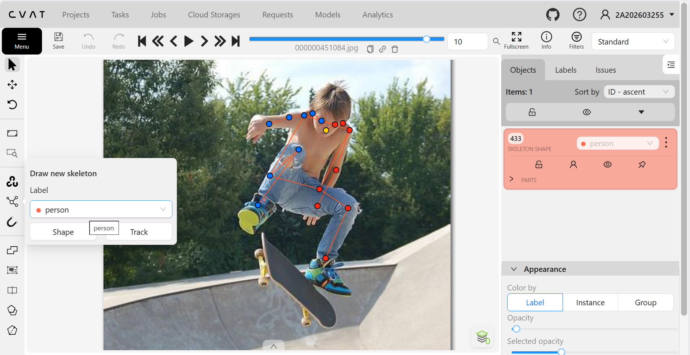
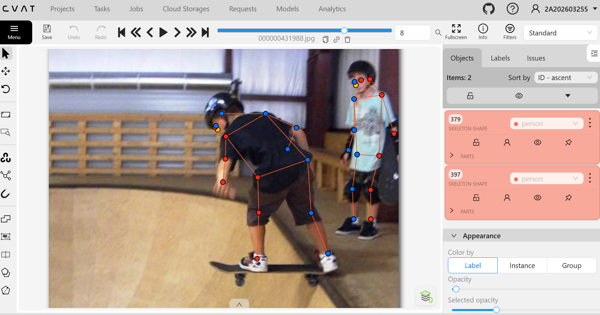
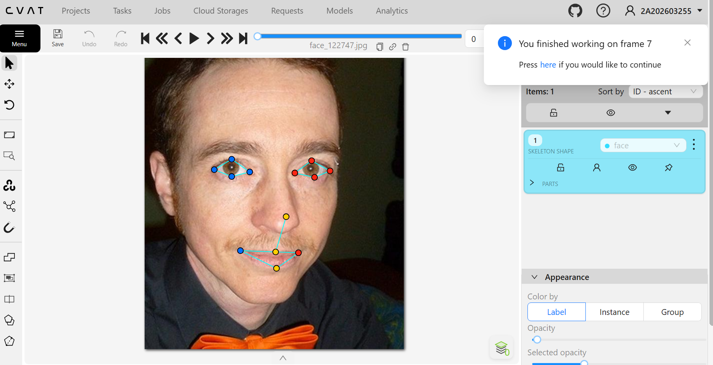
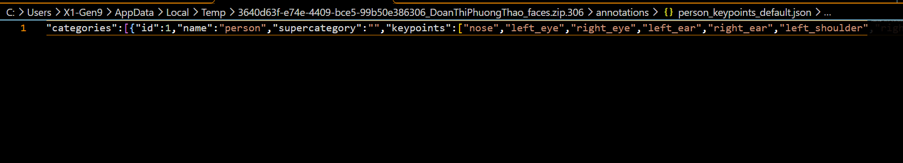

# Báo cáo cá nhân — HoVaTen-MSSV

Đổi tên file theo quy tắc `MSSV_HoTen.md`. Ví dụ: `20241234_NguyenVanAn.md`.

Dữ liệu: 12 ảnh người COCO val2017 (Lin et al., 2014) và 8 ảnh chân dung Wikimedia Commons, chỉ dùng trong lớp.

## 0. Thông tin học viên

- Họ tên: Doãn Thị Phương Thảo
- MSSV: 2A202603255
- Email: dthao18102004@gmail.com
- Link repository: https://github.com/dpthao1810/K5-L2B-2A202603255-DoanThiPhuongThao-KeypointPose-Student.git
- Phiên bản CVAT (Help → About): CVAT 2.74.1
- Máy: hệ điều hành ___ · RAM ___ GB · chạy CVAT chế độ đầy đủ
- Bộ ảnh (`src/exports/assignment.json` do `lab.py setup` tạo): có 
- Giờ bắt đầu: 16h00 ngày 12/11/2026
- Giờ kết thúc: 12h00 ngày 13/11/2026

## 1. Kiểm tra label (CP0)

| Label | Kiểu | Số điểm | Tên điểm đúng bảng của lab? | Đúng thứ tự? | Số cạnh |
|---|---|---:|---|---|---:|
| `person` | Skeleton|17 | Có – theo schema|Có – theo schema | 19|
| `face` |Skeleton |13 | Có – theo schema|Có – theo schema |13 |

Mẫu `person` dựng theo người quay mặt về camera (các điểm `left_*` nằm bên phải khung mẫu)? Có 

Cách đổi cờ `occluded` / `outside` cho **một điểm** trên phiên bản CVAT này (một câu): Rê chuột vào đúng keypoint rồi nhấn Q để chuyển sang occluded (v = 1), nhấn O để chuyển sang outside (v = 0); có thể nhấn chuột phải vào điểm để mở menu trạng thái.

...

## 2. Số lượng đã gán và thời gian (CP1, CP2)

| Nhóm ảnh | Số ảnh | Số skeleton đã gán | Số người dưới 60 px (không gán) | Số poster / gương / màn hình bỏ qua | Thời gian (phút) |
|---|---:|---:|---:|---:|---:|
| `easy` | 5 |5 |0 |0 |5p |
| `occluded` | 3 |7 | 0| 0|5p |
| `back` | 2 |5 |1 |0 |5p |
| `small` | 1 | 7|0 |0 |10p |
| `crowd` | 1 |4 |3 |0 |10p |
| `faces` | 8 |8 | — |0 |20p |

- Số ảnh người đã xong ở mốc phút 105: 10 / 10
- Thời gian thực tế (phút): CP1 35p · CP2 20p · CP3 20p
- Ảnh tốn thời gian nhất là ảnh nào, vì sao? Ảnh có nhiều người bị che khuất hoặc đứng trong tư thế chồng lấn. Một số bộ phận như tay, chân hoặc khớp bị che khuất nên cần quan sát kỹ để phân biệt bên trái – bên phải, ước lượng vị trí khớp và gán trạng thái visible, occluded hoặc outside phù hợp. Ngoài ra, cần kiểm tra lại skeleton để tránh nối nhầm keypoint giữa những người đứng gần nhau.

...

## 3. Bảng ca khó (CP1, CP2)

Mỗi điểm bạn phân vân một dòng, nhất là phân vân giữa `v = 1` và `v = 0`, hoặc không chắc hướng người.

| Ảnh | Người / mặt | Điểm | Cờ đã chọn | Phân vân giữa | Lý do chọn |
|---|---|---|---:|---|---|
|Ảnh người bị che khuất |Người  |Left wrist |v = 1 | v = 1 và v = 0|Cổ tay bị thân người khác che một phần nhưng vẫn có thể ước lượng vị trí dựa trên hướng cánh tay và cấu trúc cơ thể. |
|Ảnh người quay lưng |Người |Left eye |v = 0 |v = 1 và v = 0 |Mắt không nhìn thấy và không đủ căn cứ để xác định chính xác vị trí nên không cố gắng ước lượng. |
|Ảnh nhiều người đứng gần nhau |Người |Right ankle |v = 1 | v = 1 và v = 0|Mắt cá chân bị che một phần bởi người khác nhưng vẫn có thể suy luận vị trí từ cẳng chân và tư thế đứng. |

## 4. Bảng tự review (CP3)

Đi từ ảnh cuối về ảnh đầu. 5 ảnh người (ít nhất 2 ảnh `back` hoặc `crowd`) và 3 ảnh mặt. Ít nhất 8 dòng, kể cả dòng `ok`. Ghi lỗi trước, sửa sau.

Mã lỗi dùng đúng một trong: `lr_swap`, `vis_flag`, `position`, `missing`, `extra`, `ok`.

| Ảnh | Người / mặt | Điểm | Mã lỗi | Ghi chú | Đã sửa? |
|---|---|---|---|---|---|
|000000431988 |Người |Right wrist | position|Kiểm tra lại vị trí cổ tay, bảo đảm điểm nằm đúng khớp. |Có |
|000000021235 |Người | Left ankle|vis_flag |Kiểm tra trạng thái hiển thị của mắt cá chân bị che khuất | Có|
|000000023424 |Người |Left eye | 	vis_flag|Kiểm tra điểm mắt không nhìn thấy khi người quay lưng. |Có |
|000000431988 | Người| Left shoulder|lr_swap |Đối chiếu trái – phải theo hướng cơ thể của người trong ảnh. |Có |
|000000375535 |Người |Right knee | missing|Kiểm tra xem đã đánh dấu đầy đủ keypoint đầu gối chưa. | Có|
|face_380639 | Mặt|Nose tip |position |Kiểm tra điểm chóp mũi có nằm đúng vị trí giải phẫu không. |Có |
|face_41666 | Mặt|Left eye inner |missing | Kiểm tra điểm khó nhìn ở góc mắt trong.|Có |
|face_141135 |Mặt |Mouth left |ok |Vị trí và trạng thái keypoint phù hợp, không phát hiện lỗi. |Không cần |

Tổng hợp số lỗi theo mã:

| `lr_swap` | `vis_flag` | `position` | `missing` | `extra` | `ok` |
|---:|---:|---:|---:|---:|---:|
|1 |2 | 2|2 |0 |1 |

Điểm còn phân vân giữa `v = 1` và `v = 0` (ghi cả hai lựa chọn và lý do chọn):
Một số keypoint ở vùng tay, chân hoặc khuôn mặt bị che khuất khiến việc xác định trạng thái visibility chưa thực sự dễ dàng. Ban đầu, tôi phân vân giữa v = 1 và v = 0. Sau khi kiểm tra lại, tôi chọn v = 1 đối với những điểm bị che khuất nhưng vẫn có đủ căn cứ để ước lượng vị trí. Đối với những điểm nằm ngoài khung hình hoặc không thể xác định đáng tin cậy, tôi chọn v = 0 để tránh suy đoán vị trí.

## 5. Kiểm file xuất và kết quả tự kiểm (CP4)

Tự kiểm tay trong file JSON:

| File | Người / mặt kiểm (ảnh, thứ tự) | Số phần tử `keypoints` | Điểm `outside` ra `v = 0`, `occluded` ra `v = 1`? | `num_keypoints` khớp? |
|---|---|---:|---|---|
| `DoanThiPhuongThao_persons.zip` |Person |51  |Có | Có|
| `DoanThiPhuongThao.zip` |Person |51 |Có |Có |
| `DoanThiPhuongThao_faces.zip` |Face |39 | Có|Có |

Sau khi xuất, CVAT ghi `occluded` thành `v = 1` và `outside` thành `v = 0`. Tọa độ của điểm `outside` trong file là tọa độ cũ.

Hai job đã chuyển sang completed trên CVAT? Có

Dán phần **TÓM TẮT** in ra từ `src/check_submission.py`:

- File person: DoanThiPhuongThao_persons.zip
  Số ảnh: 12 · số skeleton person: 27 · mỗi annotation 51 số
  Skeleton theo ảnh: 000000021235=1, 000000023424=3,
  000000078170=2, 000000150500=1, 000000253584=6,
  000000326480=4, 000000375535=3, 000000399983=1,
  000000431988=2, 000000445187=1, 000000451084=1,
  000000467300=2
  Cờ v: v=2 387 (84%) · v=1 0 (0%) · v=0 72 (16%)
  num_keypoints trung bình: 14.3

- File face: DoanThiPhuongThao_faces.zip
  Số ảnh: 8 · số skeleton face: 8 · mỗi annotation 39 số
  Skeleton theo ảnh: face_122747=1, face_137371=1,
  face_141135=1, face_186226=1, face_294580=1,
  face_380639=1, face_41666=1, face_505385=1
  Cờ v: v=2 104 (100%) · v=1 0 (0%) · v=0 0 (0%)
  num_keypoints trung bình: 13.0

- Ghi chú: 72 điểm v = 0 vẫn mang tọa độ cũ
  (CVAT 2.x xuất như vậy; chuẩn COCO ghi 0, 0).
  Không phải lỗi: điểm v = 0 bị bỏ qua khi huấn luyện và khi chấm.

- Số [LỖI]: 0 · số [CẢNH BÁO]: 8
  Kết quả: ĐẠT

Các `[CẢNH BÁO]` còn giữ nguyên và lý do:

... [CẢNH BÁO] 000000023424.jpg #3: các điểm chỉ trải cao 22 px (< 60 px). Người dưới 60 px không gán; nếu người cao hơn nhưng bị cắt khung thì bỏ qua cảnh báo này.
  [CẢNH BÁO] 000000253584.jpg #1: các điểm chỉ trải cao 29 px (< 60 px). Người dưới 60 px không gán; nếu người cao hơn nhưng bị cắt khung thì bỏ qua cảnh báo này.
  [CẢNH BÁO] 000000253584.jpg #2: các điểm chỉ trải cao 28 px (< 60 px). Người dưới 60 px không gán; nếu người cao hơn nhưng bị cắt khung thì bỏ qua cảnh báo này.
  [CẢNH BÁO] 000000253584.jpg #3: các điểm chỉ trải cao 18 px (< 60 px). Người dưới 60 px không gán; nếu người cao hơn nhưng bị cắt khung thì bỏ qua cảnh báo này.
  [CẢNH BÁO] 000000253584.jpg #5: các điểm chỉ trải cao 50 px (< 60 px). Người dưới 60 px không gán; nếu người cao hơn nhưng bị cắt khung thì bỏ qua cảnh báo này.
  [CẢNH BÁO] 000000326480.jpg #4: các điểm chỉ trải cao 27 px (< 60 px). Người dưới 60 px không gán; nếu người cao hơn nhưng bị cắt khung thì bỏ qua cảnh báo này.
  [CẢNH BÁO] 000000399983.jpg #1: cặp wrist nằm ngược phía so với các cặp còn lại. Có thể đổi trái/phải một cặp (`lr_swap`), hoặc tay / chân bắt chéo thật: kiểm lại.
  [CẢNH BÁO] 000000431988.jpg #2: thấy rõ mũi và hai mắt (v = 2) nhưng các điểm left nằm bên TRÁI ảnh, tức là gán như người quay lưng. Kiểm lại hướng người (`lr_swap` cả người?).
  Các cảnh báo còn giữ nguyên chủ yếu liên quan đến kích thước người nhỏ và khả năng xác định hướng trái – phải. Đối với các trường hợp người có chiều cao keypoint dưới 60 px, cần đối chiếu ảnh gốc để xác định người có thực sự nhỏ hay bị cắt khỏi khung hình. Đối với hai cảnh báo về wrist và hướng người, cần kiểm tra lại cấu trúc skeleton, vị trí các khớp và hướng cơ thể để tránh lỗi đảo trái – phải. Tôi không tự ý chỉnh sửa dữ liệu chỉ để loại bỏ cảnh báo khi chưa có đủ căn cứ. Script không phát hiện lỗi nghiêm trọng và kết quả tổng thể là ĐẠT.

## 6. Ảnh chụp màn hình

1. Label `person` trong label constructor (đủ 17 điểm có tên):

   

2. Một người quay lưng đã gán, cờ đã đặt:

   

3. Một khuôn mặt đã gán 13 điểm, phóng to vùng mắt:

   

4. Một đoạn JSON xuất của một người:

   

Nguồn ảnh: COCO val2017 / Wikimedia Commons.

## 7. Tự đánh giá

1. Lỗi bạn mắc nhiều nhất hôm nay, và cách bạn sẽ tránh ở dự án thật:

   ...

2. Một quy tắc bạn đề xuất thêm vào guideline (kèm ảnh ví dụ nếu có):

   ...

3. Nhãn của bạn đi vào model ở đâu? Chọn một lỗi bạn đã sửa và nói nó sẽ làm model học sai thế nào (heatmap, trọng số trong loss, hay bước lật ảnh):

   ...

## 8. Khó khăn và lỗi kỹ thuật

...

## Bonus (nếu làm)

### B1 — 3 ảnh người khó thêm

| Ảnh | Số skeleton | Số người dưới 60 px | Ca khó nhất |
|---|---:|---:|---|
| | | | |
| | | | |
| | | | |

Kết quả `src/check_submission.py` cho `HoVaTen_bonus_persons.zip`:

```text
(dán ở đây)
```

### B2 — 5 ảnh khuôn mặt đen trắng / hồng ngoại

Ảnh không màu khó hơn ở điểm nào? Kính râm trên ảnh hồng ngoại có còn là `v = 1` không?

...

### B3 — Model so với nhãn của tôi (không tính điểm)

- Demo đã dùng:
- Ảnh đã thử:

1. Model có trả điểm cho khớp bị che, hay khớp ngoài ảnh không? Confidence ở các điểm đó thế nào?

   ...

2. Với người quay lưng, model có đổi trái/phải không?

   ...

3. Bộ điểm của model có giống 17 điểm COCO không?

   ...

## 9. Tài liệu tham khảo và công cụ AI đã dùng

...
